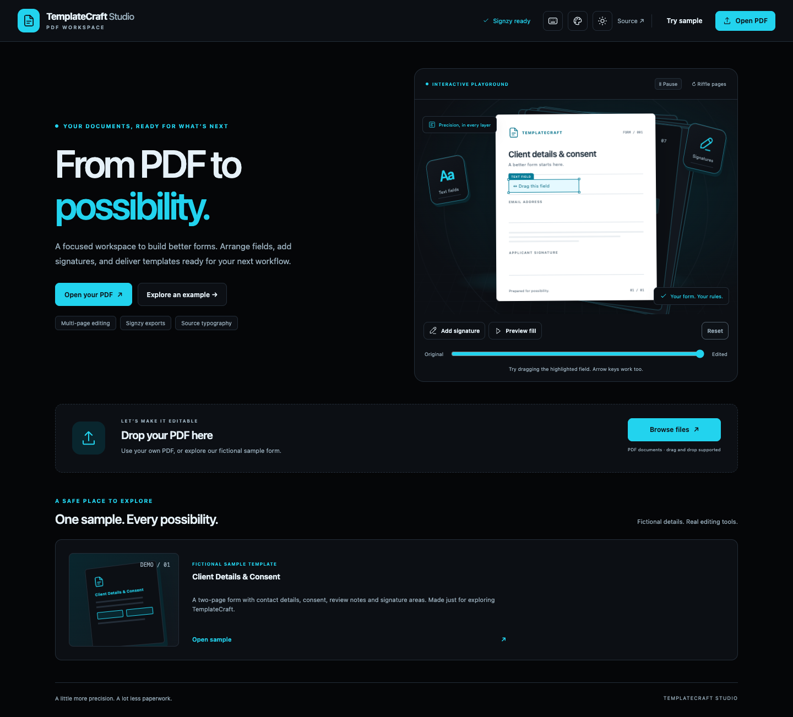

# TemplateCraft Studio

**A visual PDF workspace for fields, signatures and clean exports.**

Turn a PDF into an editable template, arrange fields across pages, update document text, place signatures/stamps, preview filled values, and export PDFs or Signzy-compatible JSON.

[Source](https://github.com/girendra003/templatecraft-studio) · [Container images](https://github.com/girendra003/templatecraft-studio/pkgs/container/templatecraft-studio) · [AGPL-3.0 license](LICENSE)



## Run with Docker

No Python or Node.js installation is needed; install Docker, then run:

```bash
docker run --detach \
  --name templatecraft-studio \
  --publish 127.0.0.1:8008:8008 \
  --read-only \
  --tmpfs /tmp:size=128m,mode=1777 \
  --cap-drop ALL \
  --security-opt no-new-privileges:true \
  ghcr.io/girendra003/templatecraft-studio:latest
```

Open **http://localhost:8008**, choose **Try sample** or upload your PDF.

```bash
# Follow logs
docker logs --follow templatecraft-studio

# Stop and start again
docker stop templatecraft-studio
docker start templatecraft-studio

# Check health
curl http://localhost:8008/api/health
```

The image supports Linux AMD64 and ARM64, including Docker Desktop on Apple Silicon. Use `:0.1.0` instead of `:latest` to select the first release. To use another local port, change the left side of the mapping, for example `127.0.0.1:8080:8008`.

**Save changes updates the active in-memory session. Download your work to keep it.** Sessions do not survive container/server restarts. This is a local/trusted-environment tool, with no authentication or account isolation; do not expose its port directly to the internet. See [deployment notes](SECURITY.md).

## Build from source

```bash
git clone https://github.com/girendra003/templatecraft-studio.git
cd templatecraft-studio
docker compose up --build --detach
```

Open http://localhost:8008. `docker compose down` stops and removes the container.

Alternatively:

```bash
docker build --tag templatecraft-studio:local .
docker run --rm -p 127.0.0.1:8008:8008 templatecraft-studio:local
```

To run the published image using the included Compose file:

```bash
docker compose pull
docker compose up --detach --no-build
```

To update a container started with `docker run`, download your work first, then stop/remove the old container, pull the new image, and repeat the run command. No volume is needed: the application does not provide persistent session storage.

## Features

- **Fields:** import existing AcroForm widgets; add, search/filter, rename, duplicate, position, resize and delete fields. Text, multiline, date, time, checkbox, signature and image zones are supported.
- **Document text:** replace selectable PDF text while retaining detected typography where possible.
- **Sign:** upload an image or use the fictional demo stamp/signature; place, resize, undo and save.
- **Test:** fill sample values, preview every page and optionally flatten the output.
- **Export:** editable PDF, blank PDF, Signzy-compatible JSON and ZIP bundle.
- Undo/redo, explicit save, unsaved-change protection, keyboard shortcuts and precise PDF-point positioning.
- Seven color palettes, independent light/dark mode, reduced-motion support and a responsive workspace.
- Interactive landing playground with paper riffle, 3D depth, Pause/Play controls, signature/fill toggles and original/edited comparison.

**Current limits:** the canvas assumes US Letter pages (612 × 792 PDF points). Other page dimensions can display incorrect overlay positions. Existing PDF fields are imported; PDFs without widgets start with an empty field list so you can add your own. There is no OCR or arbitrary-form AI detection. Image/signature zones are image placements, not cryptographic signing. Typography may fall back to portable PDF fonts. Review exported documents before use.

## Fictional sample

The only bundled form is **Client Details & Consent**: two pages, 16 field definitions, 13 blank AcroForm widgets, two signature zones and one demo stamp area. Names, `example.com` addresses and stamp/signature artwork are fictional. No real customer forms or template-specific customer mappings are distributed.

`Try sample`, the landing card and `GET /api/sample` open the same document. Rebuild the sample assets with:

```bash
python3 scripts/generate_sample.py
```

## Develop without Docker

Requires Python 3.12 and Node.js 22 for the documented release environment.

```bash
python3 -m venv .venv
source .venv/bin/activate
python3 -m pip install -r requirements.txt
cd frontend
npm ci
npm run build
cd ..
python3 run_server.py 8008
```

Or use `./run.sh` after installing dependencies. `./run.sh dev` runs the API on port 8008 and Vite on 5173; `./run.sh build` builds the frontend. The development launcher uses hot reload; Docker uses one production Uvicorn worker because sessions are process-local.

## Validation

```bash
python3 tests/test_pdf_import.py
python3 tests/test_document_edit.py
python3 tests/test_stamp_editor.py
cd frontend
npm ci
npm run build
BASE_URL=http://127.0.0.1:8008 npm run test:landing
BASE_URL=http://127.0.0.1:8008 npm run test:effects
BASE_URL=http://127.0.0.1:8008 npm run test:e2e
```

Browser tests require Chrome. Set `PUPPETEER_EXECUTABLE_PATH` on Linux or if Chrome is installed somewhere other than the macOS default. `python3 tests/test_container.py` verifies a running container on port 8020 by default; `BASE_URL` overrides that address.

## CLI

```bash
python3 fill_template.py \
  --input examples/sample_data.json \
  --output outputs/filled_sample.pdf \
  --flatten
```

The default template is the bundled sample. Pass `--template` for another AcroForm PDF and `--stamp assets/stamps/demo-stamp.png --stamp-rect 320 490 500 555` to place an image on its first page. Output directories are created automatically and outputs are ignored by Git.

## Releases and contributions

CI builds the frontend/container and tests the PDF engine, container API and browser workflows. Pushing a `v*` tag publishes versioned AMD64/ARM64 images to GHCR; the maintainer can also run the publishing workflow manually. GitHub Actions authenticate with `GITHUB_TOKEN`; do not put registry tokens in source files. On the first publication, the maintainer must set the GHCR package visibility to **Public** in its package settings so anonymous pulls work.

See [CONTRIBUTING.md](CONTRIBUTING.md), [SECURITY.md](SECURITY.md) and [THIRD_PARTY.md](THIRD_PARTY.md). Licensed under **AGPL-3.0-only**. PyMuPDF/MuPDF and other dependencies retain their own licenses and notices.
